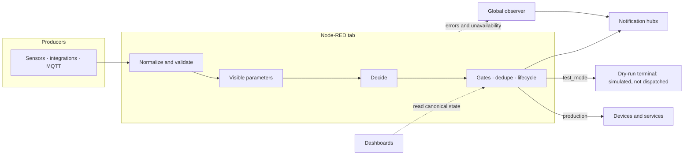
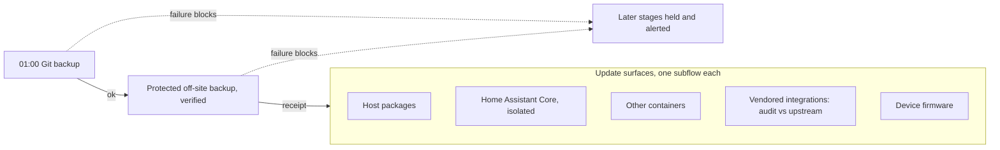

# Self-hosted Smart Home Platform

[English (default)](README.md) · [Português](README.pt-BR.md)

[](https://github.com/gabrafur/my_smart_home/actions/workflows/public-validation.yml)
[](https://www.home-assistant.io/)
[](https://nodered.org/)
[](https://docs.docker.com/compose/)
[](LICENSE)

A self-hosted, event-driven home-automation platform operated as versioned
infrastructure. Home Assistant, Node-RED, and MQTT form the core; optional
modules add Zigbee, AppDaemon, Matter, observability, an AI-assistant server
(MCP), and agent-assisted maintenance — without mixing public code with
household state.



[What it does](#what-it-does) · [How it works](#how-it-works) ·
[Try it in five minutes](#try-it-in-five-minutes) ·
[Fork it for your home](#fork-it-for-your-home) ·
[Documentation](docs/README.en.md) ·
[Engineering tour](docs/ENGINEERING_TOUR.md)

## Why this project exists

Reliable home automation is state, failure, and recovery engineering—not just
device commands. This project makes those decisions reviewable through
configuration as code, event-driven flows, stale-state guards, observability,
CI, deterministic restore, and operational documentation.

It also demonstrates how to publish a real platform without publishing the
household. Physical IDs, registries, coordinates, credentials, maps, and
history remain private. Public code uses logical roles (`resident_primary`,
`garage_gate`, `security_panel`, …) and synthetic fixtures; a fresh clone
reproduces the platform, tests, and demo, never the original install.

## What it does

Each capability lives in a Node-RED tab or a Home Assistant package, has its
own guide, and degrades safely when its module or hardware is absent.

| Area | Capabilities | Guides |
| --- | --- | --- |
| Security and access | house alarm, alarm disarm on arrival, garage gate as a single bounded pulse (position never inferred), arrival-context security lighting | [alarm](docs/ALARME_CASA_NODERED.md), [arrival disarm](docs/ALARME_DESARME_CHEGADA_NODERED.md), [gate](docs/PORTAO_GARAGEM_BOTAO_PULSO.md), [security lighting](docs/ILUMINACAO_SEGURANCA_NODERED.md) |
| Presence and vehicle | person location, arrival context, resident notifications, Hyundai/Kia vehicle integration with a staged update pipeline | [vehicle](docs/VEHICLE_PRIMARY_KIA_UVO_INTEGRATION.md), [vehicle updates](docs/VEHICLE_PRIMARY_KIA_UVO_UPDATE_RUNBOOK.md), [iCloud re-auth](docs/ICLOUD_MANUAL_AUTH.en.md) |
| Lighting and energy | exterior lighting, power controls, TV Wake-on-LAN, Raspberry Pi cooling | [exterior lighting](docs/ILUMINACAO_EXTERNA_NODERED.md), [power](docs/CONTROLE_ENERGIA_HOME_ASSISTANT.md), [Wake-on-LAN](docs/WAKE_ON_LAN_TV_SALA.md) |
| Dashboards | **Casa** (default, everyone) and admin-only **Sistema**, vehicle, map, and chat; each dashboard follows the viewer's profile language (Portuguese source, generated English copy) | [dashboards](docs/DASHBOARDS.md) |
| Observability | global Node-RED failure observer, mobile/Alexa/persistent notification hubs, Zigbee/Tuya/Internet/VPN monitors, Zigbee coordinator recovery, storage and host health, memory guardian, controlled resume after a power loss | [infrastructure](docs/ZIGBEE_HEALTH_NOTIFICATIONS.en.md), [global failures](docs/NODERED_GLOBAL_FAILURE_NOTIFICATIONS.md), [hubs](docs/NODERED_NOTIFICATION_HUBS.md), [VPN](docs/VPN_HEALTH_NOTIFICATIONS.md), [host](docs/RASPBERRY_PI_SYSTEM_HEALTH.md), [startup](docs/NODERED_STARTUP_RECOVERY.md) |
| Operations | nightly chain: Git backup → verified off-site backup → updates (host, Home Assistant Core, containers, vendored integrations, firmware); recorder retention; weekly agent documentation review | [Git backup](docs/GIT_BACKUP_NODERED.md), [containers and updates](docs/CONTAINERS.en.md#updates-and-rollback), [recorder](docs/RECORDER_RETENTION_NODERED.md), [weekly review](docs/WEEKLY_DOCUMENTATION_REVIEW.en.md) |
| AI assistants (optional) | Home Assistant agent chat (Claude Code/Codex); a Raspberry **MCP server** reachable by Claude through an OAuth edge, with read-only health tools and allow-listed household actions that confirm by readback; optional Local AI on an RTX GPU | [agent bridge](docs/CHAT_CLAUDE_CODE_HA.md), [MCP](docs/raspberry-mcp/README.md), [remote connector](docs/raspberry-mcp/remote-connector.md), [Local AI](docs/LOCAL_AI_RTX_4070.md) |
| Recovery | manifest-driven backup/restore: read-only plan/verify, human-approved apply with rollback | [restore contract](docs/RESTORE_CONTRACT.en.md) |

## How it works

### Architecture

The public core is Home Assistant ↔ MQTT ↔ Node-RED. Zigbee2MQTT, AppDaemon,
cloud-backed integrations, the agent bridge, and the MCP server are optional.
The diagram above keeps physical devices, private runtime, backup/restore, and
the agent/Local-AI boundary distinct. Bindings and physical state never enter
Git; an encrypted private bundle is applied only after plan, verify, and human
confirmation. See the [Mermaid source and reproduction](docs/assets/README.en.md).

### Who decides what

Producers report facts; Node-RED owns the decisions; dashboards only display
results. Every functional tab can be exercised with a synthetic `test_mode`
that crosses the same gates as production and stops at a dry-run terminal.



### Nightly operations chain



Updates never reboot the host, and vendored integrations are never updated
blindly: each one is compared with upstream, its local deltas reapplied and
tested. The schedule follows the Node-RED container's `TZ`, and a fresh
clone does not enable this chain.

## Try it in five minutes

Prerequisites: Linux, Git, Node.js 20, Python 3, GNU Make, Docker Engine, and
the Compose plugin. Nothing here touches real devices.

```bash
git clone https://github.com/gabrafur/my_smart_home.git smart-home
cd smart-home
make bootstrap-test
make validate-public
make demo
make demo-test
```

The demo covers logical presence, security, lighting, storage, and health
recovery, including alert deduplication, stale-event rejection, and an
in-memory restart. Its implementation imports no network, process, MQTT, or
device-control client. See [Bootstrap and demo](docs/BOOTSTRAP_DEMO.en.md) and
the [deterministic example output](docs/demo-output.md).

## Fork it for your home

The repository is designed to be forked: logic is written against logical
roles, and everything that identifies a house lives in Git-ignored files.

1. **Fork, clone, and protect your commits.**

   ```bash
   make install-git-hooks
   make validate-public
   ```

2. **Pick modules.** The core is `homeassistant`, `nodered`, and `mosquitto`.
   Optional modules (`zigbee`, `vehicle`, `alarm`, `alexa`, `matter`,
   `portainer`, `appdaemon`, `local-ai`, `agent-bridge`,
   `raspberry-specific`, `automation`) are declared with dependencies and safe
   degradation in [`modules/features.json`](modules/features.json). Create
   private templates for the ones you want, for example
   `MODULES=core,zigbee,appdaemon make bootstrap`. Bootstrap never overwrites
   existing files and never invents passwords or coordinates.
3. **Map your devices to logical roles.** Copy
   [`bindings/private-bindings.example.json`](bindings/private-bindings.example.json)
   to `bindings/private/private-bindings.json` and point each role at your own
   entities, services, and MQTT topics. Validate without printing values:
   `node scripts/public-bindings-check.mjs --private bindings/private/private-bindings.json`.
   A missing role fails closed instead of acting on the wrong device.
4. **Fill your secrets.** `.env`, `homeassistant/secrets.yaml`, Mosquitto
   passwords, and Node-RED credentials
   (`node scripts/setup-node-red-security.mjs`); follow
   [installation and restore](docs/INSTALLATION_RESTORE.en.md) step by step.
5. **Adapt what is specific to this house.** Dashboards live in
   `homeassistant/dashboards/` (Portuguese source plus an English catalogue,
   regenerated by `node scripts/dashboard-i18n.mjs`); tunable thresholds sit in
   named parameter groups inside each Node-RED tab; cloud integrations
   (vehicle, alarm, Alexa, iCloud), the RTX Local AI, and the Raspberry MCP are
   optional and can be left out.
6. **Start the core**, then add module profiles:

   ```bash
   docker compose -f docker-compose.yml -f compose.modules.yml up -d
   docker compose -f docker-compose.yml -f compose.modules.yml --profile zigbee up -d
   ```

7. **Check before every push**: `make privacy-check-staged` and
   `scripts/security-scan.sh --staged`. The pre-push hook runs the full
   validation.

What stays private in your fork: `.env`, `.local-secrets/`,
`bindings/private/`, `homeassistant/.storage/`, `homeassistant/secrets.yaml`,
`nodered/flows_cred.json`, and service databases. The
[public/private boundary](docs/PUBLIC_PRIVATE_BOUNDARY.en.md) and
[privacy model](docs/PRIVACY_MODEL.en.md) explain the full contract.

## Engineering highlights

| Capability | Evidence | Why it matters |
| --- | --- | --- |
| Modular core | [`modules/features.json`](modules/features.json), [`compose.modules.yml`](compose.modules.yml), [check](scripts/modules-check.mjs) | a clone starts with three services and expands without implicit dependencies |
| Recoverable flows | [`flows.json`](nodered/flows.json), [canvas style guide](docs/node-red/CANVAS_STYLE_GUIDE.md), [visual migration inventory](docs/NODERED_VISUAL_MIGRATION_INVENTORY.md), [replays](nodered/tools/test-security-recovery-flow.mjs), [adversarial cases](nodered/tools/test-security-recovery-adversarial.mjs) | restarts, event order, and invalid state fail safely |
| Testable flows | [manual-test policy](nodered/tools/manual-test-policy.json), [global observer replay](nodered/tools/test-global-flow-observer.mjs) | every tab declares how it is tested without a real occurrence or physical effect |
| Observability | [monitoring](docs/ZIGBEE_HEALTH_NOTIFICATIONS.en.md), [VPN health](docs/VPN_HEALTH_NOTIFICATIONS.md), [global Node-RED failures](docs/NODERED_GLOBAL_FAILURE_NOTIFICATIONS.md), [Codex alerts](docs/CODEX_ALERTAS_NODERED.md), [host health](docs/RASPBERRY_PI_SYSTEM_HEALTH.md), [runtime tests](nodered/tools/test-infrastructure-monitoring-runtime.mjs) | outage, recovery, and deduplication are testable states, not only logs |
| Bounded AI tools | [MCP architecture](docs/raspberry-mcp/architecture.md), [household actions](docs/raspberry-mcp/reference/household-lights.md), [live state](docs/raspberry-mcp/reference/home-assistant-states.md) | assistants act through allow-lists, rate limits, confirmation, and readback, never raw admin access |
| Operational policies | [recorder retention](docs/RECORDER_RETENTION_NODERED.md), [weekly review](docs/WEEKLY_DOCUMENTATION_REVIEW.en.md), [restore contract](docs/RESTORE_CONTRACT.en.md) | schedules, thresholds, and recovery ownership stay versioned and reviewable |
| Public/private boundary | [schema](bindings/public-bindings.schema.json), [model](docs/PRIVACY_MODEL.en.md), [scanner](scripts/privacy-check.mjs) | logic remains reviewable without exposing topology or physical identities |
| Disaster recovery | [manifest](restore/private-state-manifest.yaml), [implementation](scripts/restore.mjs), [tests](scripts/restore.test.mjs) | verify is read-only; apply validates its destination and prepares rollback |
| Canonical validation | [Makefile](Makefile), [CI](.github/workflows/public-validation.yml), [strategy](docs/TESTING_STRATEGY.en.md) | one local/remote command covers configuration, docs, privacy, and runtime |
| Provenance | [inventory](docs/DEPENDENCY_PROVENANCE.en.md), [notices](THIRD_PARTY_NOTICES.md) | vendored versions, licenses, and local deltas are explicit |
| Agent context | [contract](docs/MEMORIA_VERSIONADA_AGENTES.md), [recovery](scripts/ai-context-recovery.mjs) | agents resume from commit and public memory, never automatic private runtime |

The [staged engineering tour](docs/ENGINEERING_TOUR.md) offers a 30-second
architecture scan, a five-minute reliability/privacy review, and a 15-minute
implementation walkthrough.

## Execution boundaries

| Area | What runs | What never happens automatically |
| --- | --- | --- |
| Demo | in-memory logical events, no network/process/MQTT/device clients | no physical command or private-state read |
| Validation | parsers, scanners, tests, and an isolated Node-RED container with fixtures | it does not start the household stack or restore a real backup |
| Core | Home Assistant, Node-RED, and Mosquitto after private setup | optional modules are never inferred or enabled |
| Integrations | only with the selected module, binding, secret, and hardware | absence degrades safely; registries are not migrated |
| Restore | read-only plan/verify | apply needs a destination, explicit token, and human presence |
| MCP assistant tools | read-only health tools; household actions only for allow-listed services, with connector confirmation, rate limits, and readback | host shutdown/reboot, Home Assistant administration, and the raw gate relay are denied in code |
| Agents/Local AI | optional, allowed to process bounded public context | no secrets, production approval, security decision, or destructive authority |

## Restore

The repository is the public layer; installation recovery state belongs in an
encrypted private bundle. Use `backup-plan`, `backup-verify`, `restore-plan`,
and `restore-verify`; `restore-apply` requires a confirmation token. Full
contract: [RESTORE_CONTRACT](docs/RESTORE_CONTRACT.en.md).
The public off-site policy is a disabled example; an installation's active
policy belongs in the Git-ignored `.local-secrets/` directory. When updating an
older installation, copy and verify its former tracked policy **before** pulling
the version that removes it. The recorded restore drills checked archive
structure, checksums, and selected database integrity; they did not start
restored services. An independent outside-host availability monitor is
proposed, not deployed.

## Security and privacy

Scanners never echo a finding's value. Report vulnerabilities through
[SECURITY](SECURITY.md), never a public issue. Vendored dependencies retain
their own licenses and notices.

## Repository map

```text
homeassistant/   Configuration, dashboards (+ generated English copies), packages, integrations
nodered/         Flows, settings, layout tools, and runtime replays
bindings/        Public schema and synthetic example
modules/         Core/optional feature graph
restore/         Private-state manifest and schema
scripts/         Bootstrap, demo, restore, scanners, validation, MCP server sources
ia-bridge/       Optional Home Assistant agent bridge
docs/            Operations, architecture, cases, bilingual portfolio
.codex/memories/ Sanitized public agent memory
```

## Stack

Home Assistant · Node-RED · Mosquitto/MQTT · Zigbee2MQTT · AppDaemon · Matter
Server · Docker Compose · Node.js · Python · YAML/Jinja · GitHub Actions ·
Mermaid · MCP · optional Codex/Claude/Local AI.

## License and contributions

Original project code, configuration, flows, and documentation are licensed
under [GNU GPL v3.0 only](LICENSE) (`GPL-3.0-only`). Forks are welcome, and so
are contributions back through pull requests; see
[CONTRIBUTING](CONTRIBUTING.md) and the [Code of Conduct](CODE_OF_CONDUCT.md).
Private use does not require publication. If you distribute a covered modified
version, provide its corresponding source and required notices to recipients
under the GPL. Vendored components retain their own licenses and authorship;
see [third-party notices](THIRD_PARTY_NOTICES.md).

## Disclaimer

This is an independent engineering portfolio project. It is not a security
product, emergency service, or ready-made image for every household. Cloud
integrations and trademarks belong to their owners. Assess licensing, hardware,
risk, and local regulation before operating physical effects.
