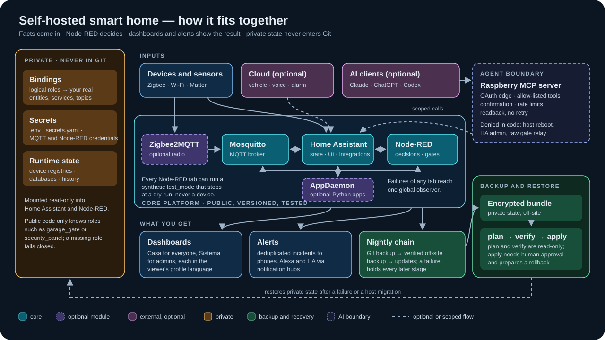
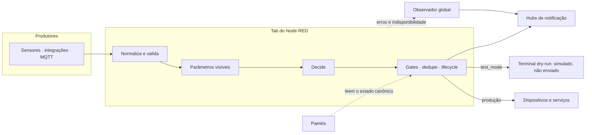
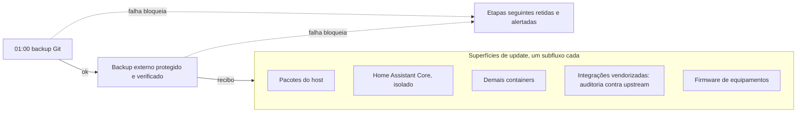

# Plataforma Self-hosted de Smart Home

[English (padrão)](README.md) · [Português](README.pt-BR.md)

[](https://github.com/gabrafur/my_smart_home/actions/workflows/public-validation.yml)
[](https://www.home-assistant.io/)
[](https://nodered.org/)
[](https://docs.docker.com/compose/)
[](LICENSE)

Plataforma de automação residencial self-hosted, orientada a eventos e
operada como infraestrutura versionada. Home Assistant, Node-RED e MQTT formam
o core; módulos opcionais adicionam Zigbee, AppDaemon, Matter,
observabilidade, um servidor para assistentes de IA (MCP) e manutenção
assistida por agentes — sem misturar código público com estado da residência.



[O que faz](#o-que-faz) · [Como funciona](#como-funciona) ·
[Teste em 5 minutos](#teste-em-5-minutos) ·
[Faça um fork para a sua casa](#faça-um-fork-para-a-sua-casa) ·
[Documentação](docs/README.md) ·
[Tour técnico](docs/ENGINEERING_TOUR.pt-BR.md) ·
[Changelog](docs/CHANGELOG.md)

## Por que este projeto existe

Automação residencial confiável é engenharia de estado, falhas e recuperação —
não apenas comandos de dispositivo. Este projeto torna essas decisões
revisáveis: configuração como código, fluxos event-driven, guards contra estado
stale, observabilidade, CI, restore determinístico e documentação operacional.

O repositório também demonstra como publicar uma plataforma real sem publicar
a casa. IDs físicos, registries, coordenadas, credenciais, mapas e históricos
permanecem privados. O código usa papéis lógicos (`resident_primary`,
`garage_gate`, `security_panel`, …) e fixtures sintéticas; um clone novo
reproduz plataforma, testes e demo, mas nunca a instalação original.

## O que faz

Cada capacidade vive num tab do Node-RED ou num pacote do Home Assistant, tem
guia próprio e degrada com segurança quando o módulo ou o hardware não existe.

| Área | Capacidades | Guias |
| --- | --- | --- |
| Segurança e acesso | alarme da casa, desarme na chegada, portão da garagem como pulso único e limitado (sem inferir posição), iluminação de segurança por contexto de chegada | [alarme](docs/ALARME_CASA_NODERED.md), [desarme na chegada](docs/ALARME_DESARME_CHEGADA_NODERED.md), [portão](docs/PORTAO_GARAGEM_BOTAO_PULSO.md), [iluminação de segurança](docs/ILUMINACAO_SEGURANCA_NODERED.md) |
| Presença e veículo | localização de pessoas, contexto de chegada, notificações de moradores, integração Hyundai/Kia com pipeline de atualização em etapas | [veículo](docs/VEHICLE_PRIMARY_KIA_UVO_INTEGRATION.md), [atualização do veículo](docs/VEHICLE_PRIMARY_KIA_UVO_UPDATE_RUNBOOK.md), [reautenticação iCloud](docs/ICLOUD_MANUAL_AUTH.md) |
| Iluminação e energia | iluminação externa, controle de energia, Wake-on-LAN da TV, resfriamento do Raspberry Pi | [iluminação externa](docs/ILUMINACAO_EXTERNA_NODERED.md), [energia](docs/CONTROLE_ENERGIA_HOME_ASSISTANT.md), [Wake-on-LAN](docs/WAKE_ON_LAN_TV_SALA.md) |
| Painéis | **Casa** (padrão, todos) e **Sistema** (só administradores), veículo, mapa e chat; cada painel segue o idioma do perfil de quem vê (fonte em português, cópia em inglês gerada) | [painéis](docs/DASHBOARDS.md) |
| Observabilidade | observador global de falhas do Node-RED, hubs de notificação (celular, Alexa, persistente), monitores de Zigbee/Tuya/Internet/VPN, recuperação do coordenador Zigbee, saúde de storage e host, guardião de memória, retomada controlada após falta de energia | [infraestrutura](docs/ZIGBEE_HEALTH_NOTIFICATIONS.md), [falhas globais](docs/NODERED_GLOBAL_FAILURE_NOTIFICATIONS.md), [hubs](docs/NODERED_NOTIFICATION_HUBS.md), [VPN](docs/VPN_HEALTH_NOTIFICATIONS.md), [host](docs/RASPBERRY_PI_SYSTEM_HEALTH.md), [retomada](docs/NODERED_STARTUP_RECOVERY.md) |
| Operação | cadeia noturna: backup Git → backup externo verificado → updates (host, Home Assistant Core, containers, integrações vendorizadas, firmware); retenção do Recorder; revisão semanal da documentação por agente | [backup Git](docs/GIT_BACKUP_NODERED.md), [containers e updates](docs/CONTAINERS.md), [Recorder](docs/RECORDER_RETENTION_NODERED.md), [revisão semanal](docs/REVISAO_DOCUMENTACAO_SEMANAL.md) |
| Assistentes de IA (opcional) | chat com agentes no Home Assistant (Claude Code/Codex); **servidor MCP** do Raspberry acessível ao Claude por um edge OAuth, com ferramentas de saúde somente leitura e ações residenciais em allowlist confirmadas por leitura de volta; Local AI opcional numa GPU RTX | [bridge de agentes](docs/CHAT_CLAUDE_CODE_HA.md), [MCP](docs/raspberry-mcp/README.md), [conector remoto](docs/raspberry-mcp/remote-connector.md), [Local AI](docs/LOCAL_AI_RTX_4070.md) |
| Recuperação | backup/restore por manifesto: plan/verify somente leitura, apply com aprovação humana e rollback | [contrato de restore](docs/RESTORE_CONTRACT.md) |

## Como funciona

### Arquitetura

O core público é Home Assistant ↔ MQTT ↔ Node-RED. Zigbee2MQTT, AppDaemon,
integrações cloud, o bridge de agentes e o servidor MCP são opcionais. A
visão geral acima mantém dispositivos físicos, runtime privado, backup/restore
e a fronteira de agentes separados; o
[diagrama detalhado de arquitetura](docs/assets/smart-home-architecture.svg)
mostra cada dependência. Bindings e estado físico nunca entram
no Git; um bundle privado criptografado só é aplicado depois de `plan`,
`verify` e confirmação humana. Veja a
[fonte Mermaid e reprodução](docs/assets/README.md).

### Quem decide o quê

Produtores informam fatos; o Node-RED é dono das decisões; painéis apenas
exibem resultados. Todo tab funcional pode ser exercitado com um `test_mode`
sintético que atravessa os mesmos gates da produção e termina num terminal
dry-run.



### Cadeia noturna de operação



Updates nunca reiniciam o host, e integrações vendorizadas nunca são
atualizadas às cegas: cada uma é comparada ao upstream e tem seus deltas
locais reaplicados e testados. O horário segue o `TZ` do container Node-RED,
e um clone novo não ativa essa cadeia.

## Teste em 5 minutos

Pré-requisitos: Linux, Git, Node.js 20, Python 3, GNU Make, Docker Engine e o
plugin Compose. Nada aqui aciona dispositivos reais.

```bash
git clone https://github.com/gabrafur/my_smart_home.git smart-home
cd smart-home
make bootstrap-test
make validate-public
make demo
make demo-test
```

A demo cobre presença lógica, segurança, iluminação, storage e recuperação de
saúde, inclusive deduplicação de alertas, rejeição de evento stale e restart em
memória. A implementação não importa clientes de rede, processo, MQTT ou
controle de dispositivos. Veja [Bootstrap e demo](docs/BOOTSTRAP_DEMO.md) e a
[saída determinística de exemplo](docs/demo-output.pt-BR.md).

## Faça um fork para a sua casa

O repositório foi pensado para fork: a lógica é escrita contra papéis lógicos,
e tudo que identifica uma casa fica em arquivos ignorados pelo Git.

1. **Faça o fork, clone e proteja seus commits.**

   ```bash
   make install-git-hooks
   make validate-public
   ```

2. **Escolha os módulos.** O core é `homeassistant`, `nodered` e `mosquitto`.
   Os módulos opcionais (`zigbee`, `vehicle`, `alarm`, `alexa`, `matter`,
   `portainer`, `appdaemon`, `local-ai`, `agent-bridge`,
   `raspberry-specific`, `automation`) declaram dependências e degradação
   segura em [`modules/features.json`](modules/features.json). Crie os
   templates privados dos que você quer, por exemplo
   `MODULES=core,zigbee,appdaemon make bootstrap`. O bootstrap nunca
   sobrescreve arquivos existentes nem inventa senhas ou coordenadas.
3. **Mapeie seus dispositivos para papéis lógicos.** Copie
   [`bindings/private-bindings.example.json`](bindings/private-bindings.example.json)
   para `bindings/private/private-bindings.json` e aponte cada papel para suas
   entidades, serviços e tópicos MQTT. Valide sem imprimir valores:
   `node scripts/public-bindings-check.mjs --private bindings/private/private-bindings.json`.
   Papel ausente falha fechado, em vez de agir no dispositivo errado.
4. **Preencha seus segredos.** `.env`, `homeassistant/secrets.yaml`, senhas do
   Mosquitto e credenciais do Node-RED
   (`node scripts/setup-node-red-security.mjs`); siga
   [instalação e restauração](docs/INSTALACAO_RESTAURACAO_SMART_HOME.md) passo a
   passo.
5. **Adapte o que é específico desta casa.** Os painéis ficam em
   `homeassistant/dashboards/` (fonte em português mais um catálogo em inglês,
   regenerado por `node scripts/dashboard-i18n.mjs`); limites ajustáveis ficam
   em grupos nomeados de parâmetros dentro de cada tab do Node-RED; integrações
   cloud (veículo, alarme, Alexa, iCloud), a Local AI com RTX e o MCP do
   Raspberry são opcionais e podem ficar de fora.
6. **Suba o core** e depois acrescente perfis de módulos:

   ```bash
   docker compose -f docker-compose.yml -f compose.modules.yml up -d
   docker compose -f docker-compose.yml -f compose.modules.yml --profile zigbee up -d
   ```

7. **Acompanhe as versões, não a `main`.** A `main` recebe commits
   automáticos todos os dias; as versões com tag (`vAAAA.MM.N`) são publicadas
   como Releases no GitHub com notas do [changelog](docs/CHANGELOG.md).
   Atualize seu fork a partir de uma tag de versão.
8. **Confira antes de cada push**: `make privacy-check-staged` e
   `scripts/security-scan.sh --staged`. O hook de pre-push roda a validação
   completa.

O que continua privado no seu fork: `.env`, `.local-secrets/`,
`bindings/private/`, `homeassistant/.storage/`, `homeassistant/secrets.yaml`,
`nodered/flows_cred.json` e os bancos dos serviços. A
[fronteira pública e privada](docs/PUBLIC_PRIVATE_BOUNDARY.md) e o
[modelo de privacidade](docs/PRIVACY_MODEL.md) explicam o contrato completo.

## Engineering highlights

| Capability | Evidência | Por que importa |
| --- | --- | --- |
| Core modular | [`modules/features.json`](modules/features.json), [`compose.modules.yml`](compose.modules.yml), [teste](scripts/modules-check.mjs) | um clone começa com três serviços e adiciona módulos sem dependências implícitas |
| Flows com recovery | [`flows.json`](nodered/flows.json), [guia visual dos canvases](docs/node-red/CANVAS_STYLE_GUIDE.md), [inventário da migração visual](docs/NODERED_VISUAL_MIGRATION_INVENTORY.md), [replays](nodered/tools/test-security-recovery-flow.mjs), [casos adversariais](nodered/tools/test-security-recovery-adversarial.mjs) | restart, ordem de eventos e estado inválido falham de forma segura |
| Flows testáveis | [política de teste manual](nodered/tools/manual-test-policy.json), [replay do observador global](nodered/tools/test-global-flow-observer.mjs) | todo tab declara como é testado sem ocorrência real nem efeito físico |
| Observabilidade | [monitoramento](docs/ZIGBEE_HEALTH_NOTIFICATIONS.md), [saúde das VPNs](docs/VPN_HEALTH_NOTIFICATIONS.md), [falhas globais do Node-RED](docs/NODERED_GLOBAL_FAILURE_NOTIFICATIONS.md), [alertas Codex](docs/CODEX_ALERTAS_NODERED.md), [saúde do host](docs/RASPBERRY_PI_SYSTEM_HEALTH.md), [testes de runtime](nodered/tools/test-infrastructure-monitoring-runtime.mjs) | falha, recuperação e deduplicação são estados testáveis, não só logs |
| Ferramentas de IA limitadas | [arquitetura do MCP](docs/raspberry-mcp/architecture.md), [ações da casa](docs/raspberry-mcp/reference/household-lights.md), [estado ao vivo](docs/raspberry-mcp/reference/home-assistant-states.md) | assistentes agem por allowlist, limite de taxa, confirmação e leitura de volta, nunca com acesso administrativo bruto |
| Políticas operacionais | [retenção do Recorder](docs/RECORDER_RETENTION_NODERED.md), [revisão semanal](docs/REVISAO_DOCUMENTACAO_SEMANAL.md), [contrato de restore](docs/RESTORE_CONTRACT.md) | agendas, limites e responsabilidade pela recuperação ficam versionados e revisáveis |
| Fronteira pública/privada | [schema](bindings/public-bindings.schema.json), [modelo](docs/PRIVACY_MODEL.md), [scanner](scripts/privacy-check.mjs) | permite revisar lógica sem expor topologia ou identidades físicas |
| Disaster recovery | [manifesto](restore/private-state-manifest.yaml), [implementação](scripts/restore.mjs), [testes](scripts/restore.test.mjs) | verify é somente leitura; apply valida destino e prepara rollback |
| Validação canônica | [Makefile](Makefile), [CI](.github/workflows/public-validation.yml), [estratégia](docs/ESTRATEGIA_DE_TESTES.md) | o mesmo comando local e remoto cobre configuração, docs, privacidade e runtime |
| Proveniência | [inventário](docs/DEPENDENCY_PROVENANCE.md), [notices](THIRD_PARTY_NOTICES.md) | versões, licenças e deltas locais de integrações vendorizadas ficam explícitos |
| Contexto de agentes | [contrato](docs/MEMORIA_VERSIONADA_AGENTES.md), [recovery](scripts/ai-context-recovery.mjs) | agentes retomam pelo commit e memória pública, nunca por runtime privado automático |

O [tour de engenharia por profundidade](docs/ENGINEERING_TOUR.pt-BR.md) oferece
uma leitura de 30 segundos da arquitetura, uma revisão de cinco minutos sobre
confiabilidade/privacidade e uma inspeção de 15 minutos da implementação.

## Limites de execução

| Área | O que roda | O que não acontece automaticamente |
| --- | --- | --- |
| Demo | eventos lógicos em memória, sem rede/processos/MQTT/dispositivos | nenhum comando físico ou leitura de estado privado |
| Validação | parsers, scanners, testes e container Node-RED isolado com fixtures | não inicia a stack residencial nem restaura backup real |
| Core | Home Assistant, Node-RED e Mosquitto após configuração privada | módulos opcionais não são ativados por inferência |
| Integrações | somente quando módulo, binding, secret e hardware são fornecidos | ausência degrada com segurança; não migra registry |
| Restore | plan/verify somente leitura | apply exige destino, confirmação explícita e presença humana |
| Ferramentas MCP de assistentes | ferramentas de saúde somente leitura; ações residenciais só em serviços da allowlist, com confirmação no conector, limite de taxa e leitura de volta | desligar/reiniciar o host, administrar o Home Assistant e acionar o relé bruto do portão são negados no código |
| Agentes/Local AI | opcionais, com contexto público permitido | não recebem segredos nem aprovam produção, segurança ou ações destrutivas |

## Restore

O repositório é a camada pública; o estado necessário para recuperar uma
instalação vive num bundle privado criptografado. Use os alvos `backup-plan`,
`backup-verify`, `restore-plan` e `restore-verify`; `restore-apply` exige token
de confirmação. Contrato completo: [RESTORE_CONTRACT](docs/RESTORE_CONTRACT.md).
O exemplo público da política off-site vem desativado; a política ativa de cada
instalação fica em `.local-secrets/`, ignorada pelo Git. Ao atualizar uma
instalação antiga, copie e confira a política **antes** do `git pull` que
remove o arquivo versionado. Os ensaios registrados verificaram estrutura do
arquivo, checksums e parte da integridade do banco; não iniciaram serviços
restaurados. Um monitor de disponibilidade independente e externo ao host foi
proposto, mas não instalado.

## Segurança e privacidade

O scanner não ecoa achados. Vulnerabilidades seguem [SECURITY](SECURITY.md),
nunca uma issue pública. Dependências vendorizadas preservam licenças e avisos
próprios.

## Mapa do repositório

```text
homeassistant/   Configuração, painéis (+ cópias em inglês geradas), pacotes e integrações
nodered/         Flows, settings, ferramentas de layout e replays de runtime
bindings/        Schema público e exemplo sintético
modules/         Grafo de features core/opcionais
restore/         Manifesto e schema do estado privado
scripts/         Bootstrap, demo, restore, scanners, validação e fontes do servidor MCP
ia-bridge/       Bridge opcional de agentes no Home Assistant
docs/            Operação, arquitetura, cases e portfólio bilíngue
.codex/memories/ Memória pública sanitizada dos agentes
```

## Stack

Home Assistant · Node-RED · Mosquitto/MQTT · Zigbee2MQTT · AppDaemon · Matter
Server · Docker Compose · Node.js · Python · YAML/Jinja · GitHub Actions ·
Mermaid · MCP · Codex/Claude/Local AI opcionais.

## Licença e contribuições

O código, a configuração, os fluxos e a documentação originais do projeto
estão sob [GNU GPL v3.0 somente](LICENSE) (`GPL-3.0-only`). Forks são
bem-vindos, assim como contribuições por pull request; veja
[CONTRIBUTING](CONTRIBUTING.md) e o [Código de Conduta](CODE_OF_CONDUCT.md).
Uso privado não obriga publicação. Ao distribuir versão modificada coberta,
forneça aos destinatários o código-fonte correspondente e os avisos exigidos
pela GPL. Componentes vendorizados preservam licenças e autoria próprias; veja
os [avisos de terceiros](THIRD_PARTY_NOTICES.pt-BR.md).

## Disclaimer

Projeto independente de engenharia e portfólio. Não é produto de segurança,
serviço de emergência nem imagem pronta para qualquer residência. Integrações
cloud e marcas pertencem a seus respectivos proprietários. Avalie riscos,
licenças, hardware e regulamentação da sua instalação antes de operar efeitos
físicos.
