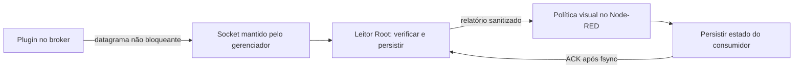

# Observação nativa de metadados MQTT

Esta é uma implementação candidata, desligada por padrão. Publicar as fontes
não instala o leitor, não carrega o plugin e não amplia permissões do MCP.
A instalação ainda exige pacote selado com aplicação, consulta, revogação e
reversão, além de aprovação específica do proprietário. A renovação de uma
autorização administrativa existente não concede esse novo acesso permanente.

## Escopo e arquitetura

O plugin acompanha sete classes: `publish_in`, `publish_out`, `connect`,
`disconnect`, `subscribe`, `unsubscribe` e `client_offline`. Os callbacks não
desreferenciam `event_data`: não coletam tópico, payload, identidade de cliente,
credenciais ou conteúdo doméstico. Um contador não cobre automaticamente todos
os eventos do Home Assistant, nem comprova entrega de notificação ou execução
do assistente.



O produtor usa `CLOCK_BOOTTIME`, sequência, contagens cumulativas e buffer
limitado. Perdas, falhas de envio e relógios desconhecidos permanecem explícitos.
O leitor verifica credenciais fornecidas pelo kernel, contêiner exato, processo,
executável, identidade do arquivo de plugin mapeado e domínio temporal.
Isso verifica arquivos e vínculos de processo; não atesta todas as instruções
executadas na memória do broker.

O gerenciador conserva o socket enquanto o processo leitor é substituído.
O novo processo abre o mesmo SQLite, preserva a fila e acrescenta a falha
`reader_restart`; reiniciar não apaga incerteza histórica. A fila é finita:
esse mecanismo não promete ausência de perdas em uma parada arbitrariamente longa.

O tab `observacao_mqtt_nativa` contém configuração, normalização, autorização,
idade do leitor, decisões de integridade e latência, dedupe e gate final.
O padrão é `enabled: false`, com limite de evento de 10.000 ms. O intervalo de
leitura é de 2 s. As comparações operacionais ficam nos switches do canvas;
Python e o CLI validam fatos, arquivos e protocolo. Nenhum dashboard recalcula
essa política.

## Contratos e caminhos fixos

| Componente | Caminho ou contrato |
| --- | --- |
| Código Root selado | `/opt/raspberry-mqtt-observation/` |
| Estado Root privado | `/var/lib/raspberry-mqtt-observation/`, `0:0`, modo `0700` |
| Socket | `/run/raspberry-mqtt-observation/source.sock`, `0:1883`, modo `0620` |
| Plugin carregado no broker | `/mosquitto/metadata/observer.so`, arquivo Root somente leitura |
| Relatório para o Node-RED | `/mnt/data/docker/nodered/.mqtt-source-observer-report/`, `0:1000`, modo `0750` |
| Estado e ACK do consumidor | `/mnt/data/docker/nodered/.mqtt-source-observer-consumer/`, `1000:1000`, modo `0700` |
| Adaptador do consumidor | `/data/tools/mqtt-source-observation/consumer-command.sh` |

Os IDs acima são papéis de execução do pacote candidato atual. Outro ambiente
precisa de nova revisão das identidades, imagem, binário e montagem; não basta
trocar um ID no MCP.

O relatório contém números inteiros como strings decimais para evitar perda de
precisão no JavaScript. Esquemas fechados recusam campos extras e formatos
ambíguos. O consumidor prepara uma proposta sem escrever ACK; o canvas observa
os fatos e solicita o commit exato. O CLI usa `flock` e comparação do estado-base,
persiste e sincroniza o estado antes de publicar o ACK. O leitor mede o limite
superior até observar esse ACK durável. O resultado não mede processamento da Eva.

`no_events`, `no_new_receipt`, `busy`, `disabled` e `unknown` são resultados
distintos. Silêncio não significa recuperação. A idade usa correlação explícita
entre o domínio de boot do leitor e `CLOCK_MONOTONIC` do Node.js; domínio
diferente, relógio futuro ou idade ausente continuam desconhecidos.

## Proveniência e build

O SDK está fixado no Mosquitto 2.1.2, commit
`99fa50f30e325609394c324c8ff71cfbbe95d8ab`, objeto de tag
`691eab38b43c16235251bf4a4c83b2b29195ba76`.
O [manifesto de origem](../scripts/raspberry-mcp/runtime-source/mqtt-observation/native/sdk-manifest.json)
registra os sete arquivos oficiais, tamanho, SHA-256 e objeto Git de cada um.
Headers não são reescritos nem embutidos no repositório; o preparador verifica
seus bytes antes de disponibilizar o contexto de compilação.
As licenças e notices do SDK são preservados, com a escolha
`EPL-2.0 OR BSD-3-Clause`; o código original do observador usa a licença do projeto.

Execute a preparação sem `sudo`, usando um diretório novo:

```sh
python3 scripts/raspberry-mcp/runtime-source/mqtt-observation/native/prepare_build.py \
  /tmp/mqtt-observer-build
```

Isso baixa somente os sete arquivos fixados e copia as fontes e licenças para
esse contexto. Não compila, instala, acessa o Docker ou reinicia serviços.
O Dockerfile exporta `observer.so`, o harness de falhas e as licenças. Sua base
ARM64 está fixada na imagem efetivamente usada nos testes isolados. O compilador
e os pacotes de build ainda precisam de registro de versão no recibo de build;
o processo não afirma que builds futuros serão byte a byte reproduzíveis.

Antes de instalar, execute o harness em contêiner próprio, sem rede, sem
montagens residenciais e com limites de processo. Revalide ABI, binário do broker,
licenças, SHA do plugin e comportamento do broker com o artefato que será instalado.
Uma compilação em outra arquitetura exige nova validação nativa.

## Instalação e atualização

O pacote selado deve tornar revisáveis estes passos antes da aprovação:

1. Conferir imagem e contêiner atuais, binário, plugin, owners, modos, montagens,
   baseline da configuração e arquivos existentes, usando comparação de hashes.
2. Instalar código Root imutável, diretórios e units revisadas. O serviço normal
   recusa um SQLite ausente; o bootstrap aprovado é uma ação separada e exclusiva.
3. Criar uma autorização fechada `mqtt_metadata_seven_classes_v1`, com aprovação
   correspondente ao vínculo de origem, validade explícita ou `null` aprovado.
   A política e o vínculo não vêm de parâmetros livres de ferramentas MCP.
4. Preparar a montagem IPC e a configuração do plugin, preservando dados,
   autenticação e ACLs existentes. O Mosquitto carrega plugins ao iniciar;
   `SIGHUP` não instala este plugin. A alteração da montagem exige recriação
   somente do broker, com backup e reversão já preparados.
5. Validar o socket e o leitor antes do broker, depois observar tráfego natural,
   consumidores, persistência e ACKs. Habilitar a política do canvas somente
   dentro da aprovação correspondente.
6. Expor ao MCP somente a projeção sanitizada aprovada e comprovar uma chamada
   real. As fontes atuais, o catálogo ou um contêiner saudável não cumprem esse passo.

As units candidatas usam `LimitAS=134217728`, `CPUQuota=10%`, prioridade reduzida,
`NoNewPrivileges` e somente `CHOWN`, `DAC_READ_SEARCH`, `SYS_PTRACE` no conjunto
de capacidades. A verificação isolada de capacidades não comprova todo o perfil
de isolamento do systemd. O limite Docker `--memory` também não comprova limite
efetivo quando o host não dispõe do controlador de memória. O heap máximo do
Node.js não é um limite rígido de RSS.

Recriar o contêiner muda seu vínculo. Atualizações detectáveis devem passar pelo
tab `atualizacoes_diarias`: auditar o candidato, preservar a configuração,
revalidar ABI e arquivo mapeado, aplicar o vínculo exato por comparação e observar
um ciclo nativo. O leitor não aceita outro contêiner por semelhança de nome nem
reconfigura automaticamente esse vínculo. A integração dessa etapa no atualizador
e o instalador selado ainda são pendências da ativação.

## Revogação, reversão e recuperação

Revogação fecha a autorização e remove o marcador positivo. O plugin verifica
autorização e revogação antes de enviar, inclusive no encerramento. A perda de
autorização desabilita sua telemetria sem alterar o resultado dos callbacks do
broker; rearmar exige uma ação deliberada revisada. Não há renovação automática.

Reversão deve primeiro fechar a coleta, registrar o resultado e só então restaurar
a configuração e montagens do broker por comparação com o baseline. Preserve
dados, entidades, histórico, contagens, recibos e backups. Não reinicie o host ou
a stack para remover o observador. Não apague SQLite para obter um estado saudável.

`recovery_data.py` copia somente os dados do novo coletor: bloqueia o consumidor,
usa a API de backup online do SQLite e registra checksums. A restauração recusa
destino existente e exige autorização atual desabilitada. Ela preserva a política
e o vínculo atuais; não copia grants, propostas preparadas ou configuração de
origem do backup. O relatório é regenerado. Falhas de snapshot são preservadas.

Esse restore de metadados não comprova recuperação de Home Assistant, Node-RED,
Mosquitto, Zigbee2MQTT, Matter Server, AppDaemon ou Portainer. Cada aplicação
precisa de teste funcional isolado com sua própria evidência.

## Testes e aceite

O tab prevê reset e cenários nominal, duplicata, acima do limite, relógio
desconhecido, perda, zero eventos, fonte ausente, ocupado, formato inválido,
desabilitado, autorização fechada, domínio diferente, relógio futuro, leitor
antigo e metadados ausentes. Execute reset antes de uma sequência nova; a
duplicata usa o estado do cenário nominal. Todos atravessam a política real
até o terminal `simulated: true`, `dispatched: false`, sem exec, ACK, push ou
efeitos residenciais. Falha e indisponibilidade também usam o replay global.

Os testes do projeto descobrem o canvas e o consumidor por seus agregadores.
Fixtures Python portáveis rodam sem privilégios; fixtures de ownership só rodam
em executor Root isolado e mostram skips explicitamente em conta comum.
Execute `make validate-public` pelo wrapper canônico, sem suítes amplas paralelas.

O aceite de produção permanece separado: carga efetiva do plugin e leitor,
chamada MCP real, políticas e valores canônicos, ausência de perda, latência
medida por classe, atualizações e reversão, recursos e cobertura contínua de
24 horas. Preserve lacunas anteriores e interrupções de manutenção. Não gere
eventos domésticos nem antecipe o ciclo natural para fechar o aceite.
